# ScanArchiv – Architektur

Dieses Dokument beschreibt den Aufbau des Programms: die Module, wie sie zusammenhängen und wie die
wichtigsten Abläufe funktionieren. Die Diagramme sind in [Mermaid](https://mermaid.js.org) geschrieben
(GitHub, Xcode-Vorschau, VS Code und viele Markdown-Editoren zeigen sie direkt an). Jedes Diagramm legt
seine Farben selbst fest (helle Kästen, mittelblaue Linien), damit es auf hellem und dunklem Hintergrund
lesbar ist.

## Grundprinzipien

- **Das PDF ist der Master.** Nummer, Datum, Titel, Beschreibung, Herkunft, Probleme und Seiten-Infos
  stehen *im* PDF (versteckte Anmerkung `/ScanArchiv` auf Seite 1 plus Dokumentinfos). Der Suchindex
  ist nur ein Cache und lässt sich jederzeit aus den PDFs neu aufbauen.
- **Originale bleiben, wo möglich, bitgenau erhalten.** Bei importierten PDFs werden Stempel, OCR-Text,
  Metadaten, Umsortierungen und Drehungen per **inkrementellem Update** angehängt (`PDFAppender`).
- **Zwei Schichten:** `ScanArchivCore` (Bibliothek, ohne UI, vollständig getestet) und `ScanArchiv`
  (SwiftUI-App: Oberfläche, Scanner, Eingangsordner).
- **Nummern werden nie wiederverwendet:** maßgeblich ist das Maximum aus `counter.json` und der höchsten
  Nummer im Archivordner.

---

## 1. Schichten und Außenwelt

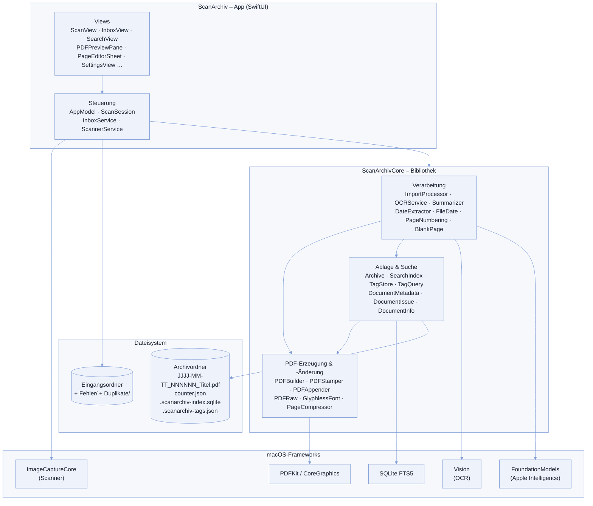

---

## 2. Module und ihre Beziehungen

### 2.1 App-Schicht

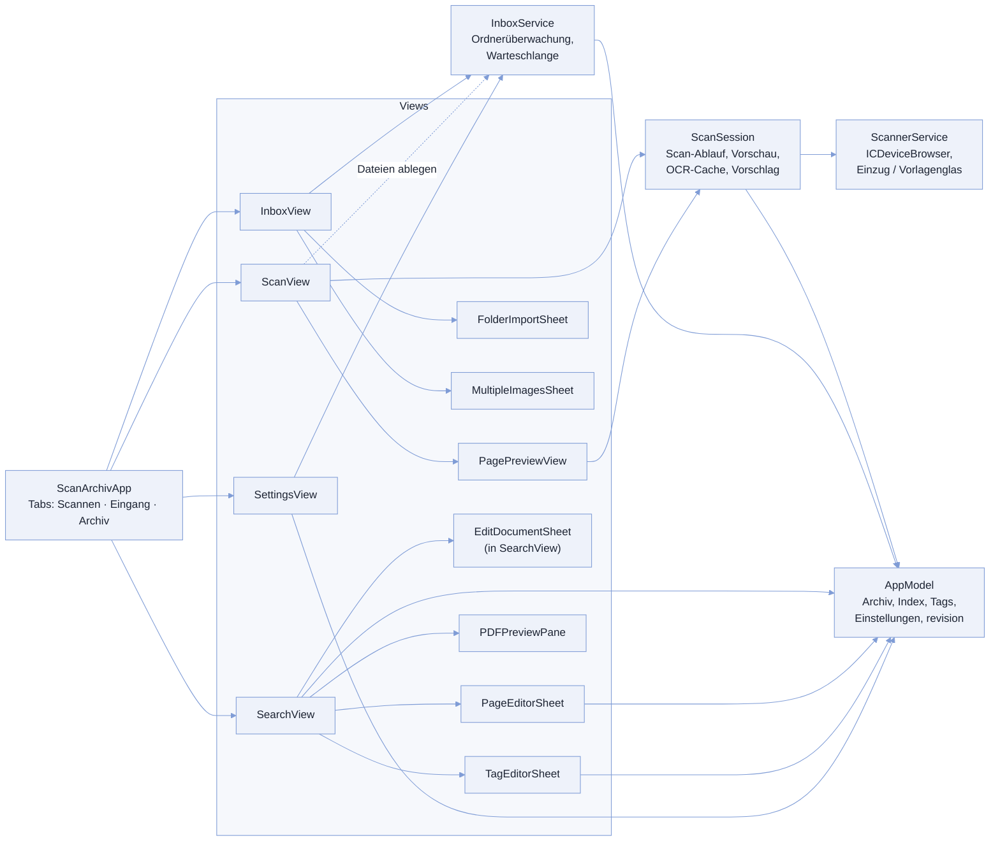

| Modul | Aufgabe |
|---|---|
| `AppModel` | Öffnet Archiv, Suchindex und Tags; Einstellungen (`SettingsKey`); Bearbeiten, Seiten bearbeiten, „Als geprüft markieren“, „Titel erzeugen“; einmalige Migrationen beim Start; `revision` löst Neuladen der Listen aus |
| `ScanSession` | Zustandsautomat des Scans (Stapel zweiteilig oder Seite für Seite), Seitenmodell mit Drehung, automatische Ausrichtung, OCR im Hintergrund, Vorschlag von Titel/Beschreibung/Datum, Reihenfolge-Hinweis, Speichern |
| `ScannerService` | Findet Scanner (Bonjour/USB), öffnet die Sitzung, wechselt Einzug ↔ Vorlagenglas, liefert PNG-Seiten |
| `InboxService` | Überwacht den Eingangsordner, kopiert abgelegte Dateien hinein, verarbeitet die Warteschlange nacheinander, sortiert Fehler und Duplikate aus |
| `SearchView` / `PDFPreviewPane` | Trefferliste mit Tags und Problemfilter, Vorschau mit Suche, Info, Drucken, Teilen |
| `PageEditorSheet` | Seiten eines archivierten Dokuments umsortieren und drehen |

### 2.2 Core-Bibliothek

```mermaid
%%{init: {"theme": "base", "themeVariables": {"lineColor": "#7f9cd6", "primaryColor": "#eef2fa", "primaryTextColor": "#1d2433", "primaryBorderColor": "#7f9cd6", "secondaryColor": "#f3f0fa", "tertiaryColor": "#f6f8fc", "clusterBkg": "#f6f8fc", "clusterBorder": "#7f9cd6", "titleColor": "#1d2433", "edgeLabelBackground": "#ffffff", "textColor": "#1d2433", "signalColor": "#7f9cd6", "signalTextColor": "#7f9cd6", "actorBkg": "#eef2fa", "actorBorder": "#7f9cd6", "actorTextColor": "#1d2433", "actorLineColor": "#7f9cd6", "labelBoxBkgColor": "#eef2fa", "labelTextColor": "#1d2433", "loopTextColor": "#7f9cd6", "noteBkgColor": "#fff7d6", "noteTextColor": "#1d2433"}, "themeCSS": ".flowchart-link, .messageLine0, .messageLine1, .actor-line { stroke-width: 2px !important; }"}}%%
flowchart TB
    subgraph Verarbeitung
        ImportProcessor
        OCRService["OCRService<br/>Texterkennung + Ausrichtung"]
        Summarizer["Summarizer<br/>Titel · Beschreibung · Datum"]
        DateExtractor
        FileDate["FileDate<br/>Name · PDF · Dateisystem"]
        PageNumbering["PageNumbering<br/>Seitenreihenfolge"]
        BlankPage["BlankPage<br/>leere Seiten"]
        PageOrder["PageOrder<br/>Duplex verzahnen"]
        ImagesToPDF
        FolderScan
    end

    subgraph PDF_Schicht["PDF"]
        PDFBuilder["PDFBuilder<br/>neues PDF aus Bildern<br/>+ ImageTools"]
        PDFStamper["PDFStamper<br/>Neuschreiben mit PDFKit"]
        PDFAppender["PDFAppender<br/>inkrementelles Update"]
        PDFRaw["PDFRaw<br/>Parser + Writer"]
        GlyphlessFont["GlyphlessFont<br/>unsichtbare Textebene"]
        PageCompressor["PageCompressor<br/>JPEG / verlustfrei / 1-Bit"]
    end

    subgraph Ablage
        Archive["Archive<br/>Nummern, Dateinamen,<br/>Metadaten ändern, Seiten umsortieren"]
        SearchIndex["SearchIndex<br/>SQLite FTS5 + Wörterbuch"]
        TagStore
        TagQuery["TagQuery<br/>AND/OR/NOT, Platzhalter"]
        DocumentMetadata["DocumentMetadata<br/>+ PDFMetadata"]
        DocumentIssue["DocumentIssue<br/>Fehler / Hinweis"]
        DocumentInfo["DocumentInfo<br/>Info-Texte"]
    end

    ImportProcessor --> OCRService & Summarizer & DateExtractor & FileDate & PageNumbering & BlankPage
    ImportProcessor --> PDFAppender & PDFStamper & PDFBuilder & PageCompressor
    ImportProcessor --> Archive & SearchIndex
    Summarizer --> DateExtractor
    PDFAppender --> PDFRaw & GlyphlessFont & PDFBuilder
    PDFBuilder --> GlyphlessFont
    PDFStamper --> PDFBuilder
    Archive --> PDFAppender & DocumentMetadata & BlankPage
    SearchIndex --> TagQuery & DocumentMetadata & DocumentIssue
    DocumentMetadata --> DocumentIssue
    DocumentInfo --> DocumentMetadata & PageNumbering
```

| Modul | Aufgabe |
|---|---|
| `ImportProcessor` | Ein PDF oder Bild archivieren: Text übernehmen oder OCR, leere Seiten, Reihenfolge, Vorschlag, Datum, bis zu drei Fassungen erzeugen, prüfen, kleinste speichern, indexieren |
| `OCRService` | Vision-Texterkennung (de/en) auf eigener serieller Queue; Ausrichtung per schneller OCR in vier Richtungen |
| `Summarizer` | Apple Intelligence (lokal): Titel, Beschreibung, Datum, Absender und Kategorien aus den ersten zwei Seiten |
| `Categories` | Kategorien als Pfade („Absender/DAK“): Startliste, Normalisieren an vorhandene, Oberkategorien, Umbenennen |
| `PDFBuilder` | Neues PDF aus Seitenbildern mit unsichtbarer Textebene und rotem Stempel (Scans, Bilder, komprimierte Fassung) |
| `PDFStamper` | Vorhandenes PDF über PDFKit neu schreiben (Alternative, falls kleiner) |
| `PDFAppender` | Stempel, Textebene, Metadaten, neue Reihenfolge und Drehung **anhängen**; Original bleibt bitgenau |
| `PDFRaw` | Eigener PDF-Parser (Querverweistabellen und -Streams, Objekt-Streams) und Writer für inkrementelle Updates |
| `Archive` | Ordner mit fortlaufender Nummer; Speichern, Umbenennen, Metadaten ändern, Seiten umsortieren, Altbestand migrieren |
| `SearchIndex` | Volltextsuche (Wortanfänge, alle Wörter UND), Tag-Filter, Kategorienfilter und -zahlen, Problemfilter, Duplikaterkennung per SHA-256, Neuaufbau aus den PDFs |

---

## 3. Datenhaltung

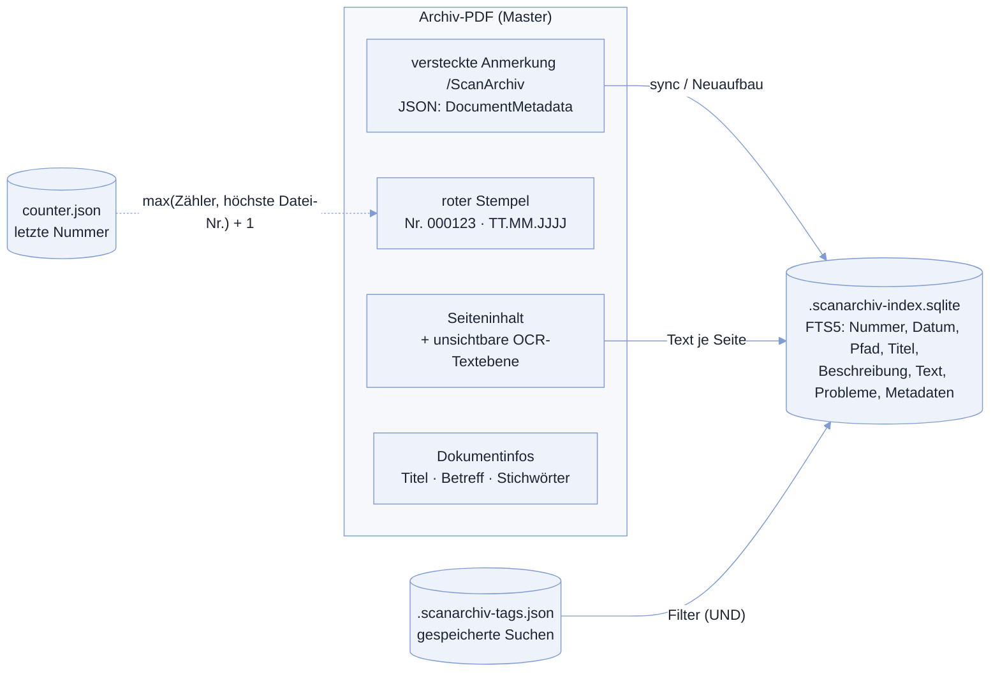

`DocumentMetadata` enthält u. a.: Nummer, Dokumentdatum und dessen Herkunft, Titel-Herkunft, Archivierungszeit,
Quelle (Scan/PDF/Bild), Originalname/-größe/-SHA-256, Scan-Einstellungen, Kompression, Textherkunft je Seite
(`embedded`, `ocr`, `none`, `blank`), OCR-Infos, Probleme, Speicherart (`appended`, `rewritten`, `rebuilt`,
`created`), ggf. `pageOrder` und die Programmversionen.

---

## 4. Abläufe

### 4.1 Stapel scannen (zweiteilig, Vorder- und Rückseiten)

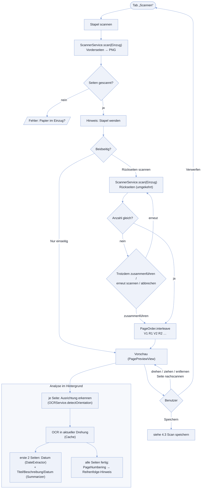

### 4.2 Seite für Seite scannen

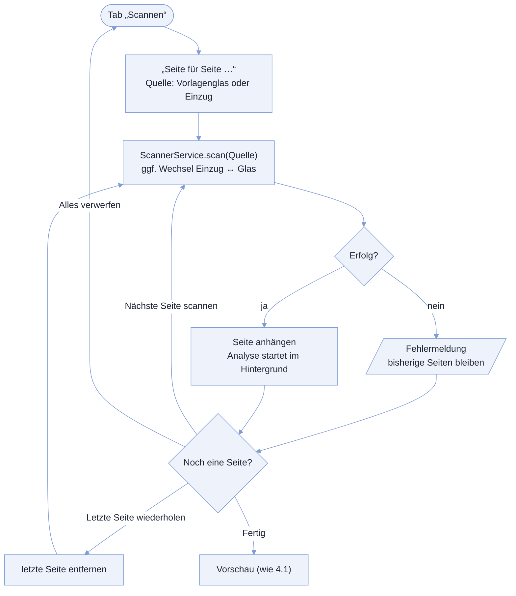

### 4.3 Scan speichern

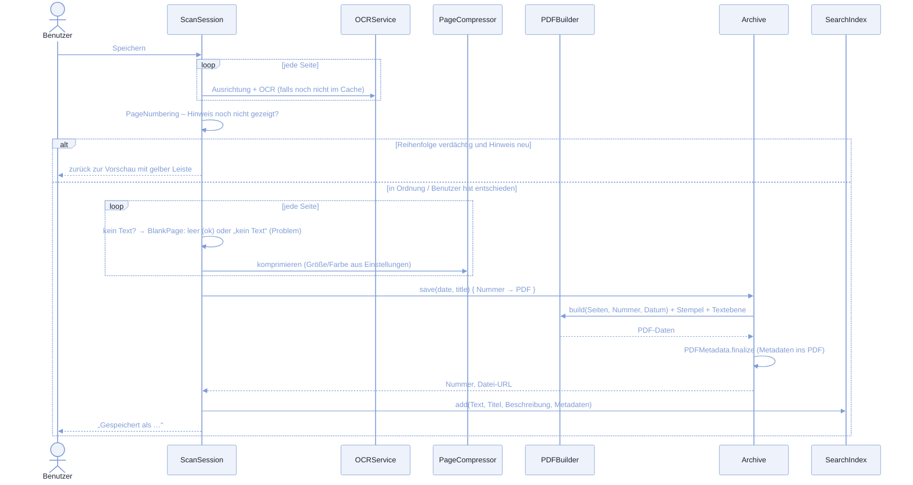

### 4.4 Import über den Eingang

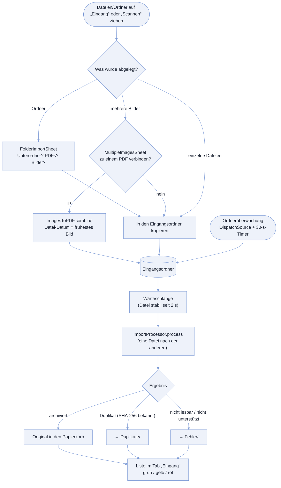

### 4.5 ImportProcessor im Detail

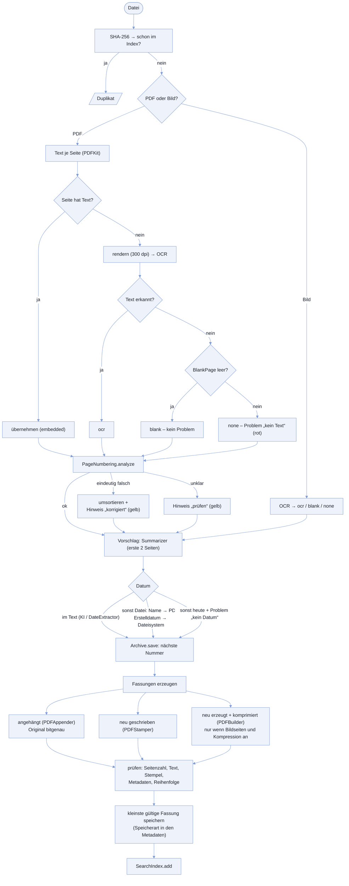

### 4.6 Suchen, Kategorien, Tags und Vorschau

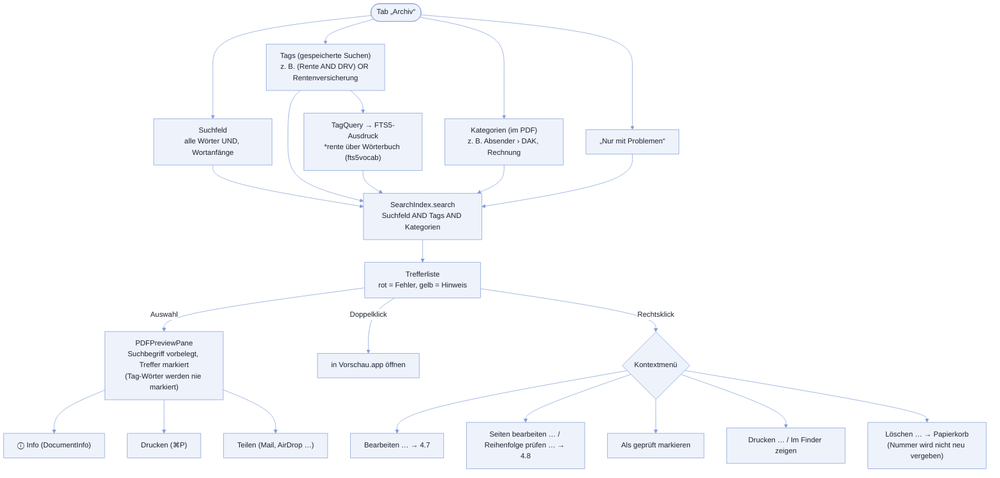

### 4.7 Datum, Titel, Beschreibung bearbeiten

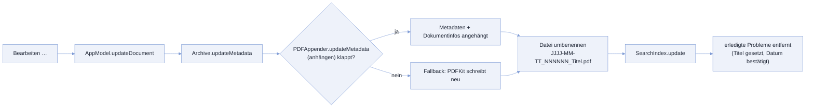

### 4.8 Seiten bearbeiten (Reihenfolge / Drehung)

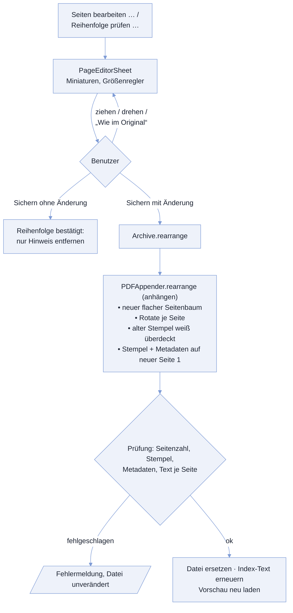

### 4.9 Programmstart und Index-Abgleich

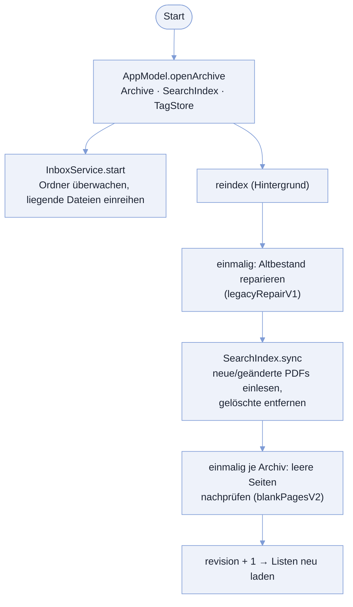

### 4.10 Titel erzeugen (Stapel)

```mermaid
%%{init: {"theme": "base", "themeVariables": {"lineColor": "#7f9cd6", "primaryColor": "#eef2fa", "primaryTextColor": "#1d2433", "primaryBorderColor": "#7f9cd6", "secondaryColor": "#f3f0fa", "tertiaryColor": "#f6f8fc", "clusterBkg": "#f6f8fc", "clusterBorder": "#7f9cd6", "titleColor": "#1d2433", "edgeLabelBackground": "#ffffff", "textColor": "#1d2433", "signalColor": "#7f9cd6", "signalTextColor": "#7f9cd6", "actorBkg": "#eef2fa", "actorBorder": "#7f9cd6", "actorTextColor": "#1d2433", "actorLineColor": "#7f9cd6", "labelBoxBkgColor": "#eef2fa", "labelTextColor": "#1d2433", "loopTextColor": "#7f9cd6", "noteBkgColor": "#fff7d6", "noteTextColor": "#1d2433"}, "themeCSS": ".flowchart-link, .messageLine0, .messageLine1, .actor-line { stroke-width: 2px !important; }"}}%%
flowchart LR
    A["„Titel erzeugen“ im Archiv"] --> B["SearchIndex: Dokumente ohne Titel"]
    B --> C["je Dokument: Text der ersten Seiten<br/>→ Summarizer (Titel, Beschreibung, Datum)"]
    C --> D["AppModel.updateDocument<br/>Titel-Herkunft: KI, Datum nur falls erkannt"]
    D --> E["Datei umbenannt, Index aktualisiert,<br/>Problem „kein Titel“ entfernt"]
```
